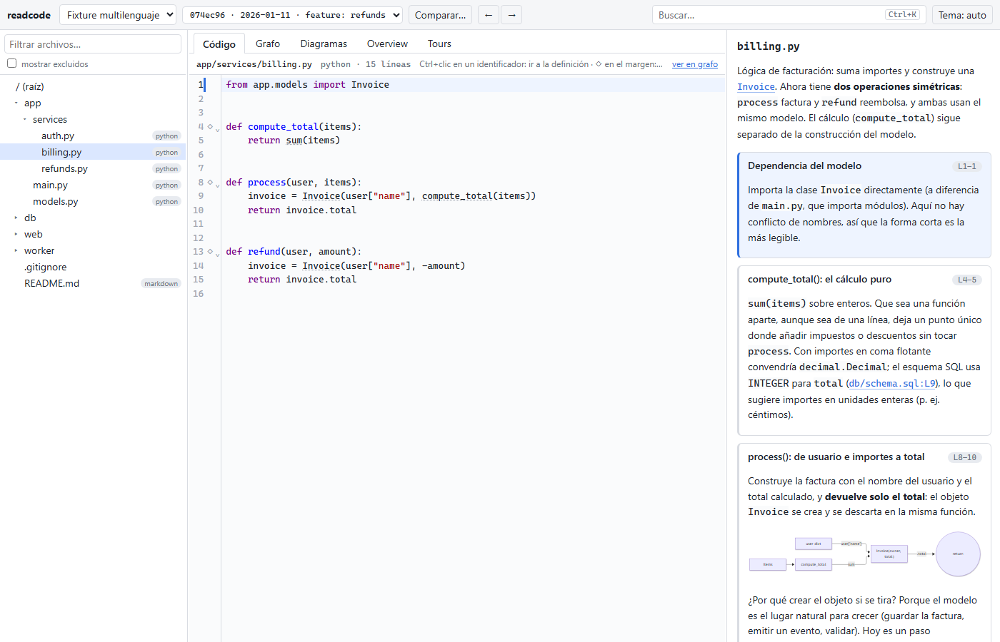
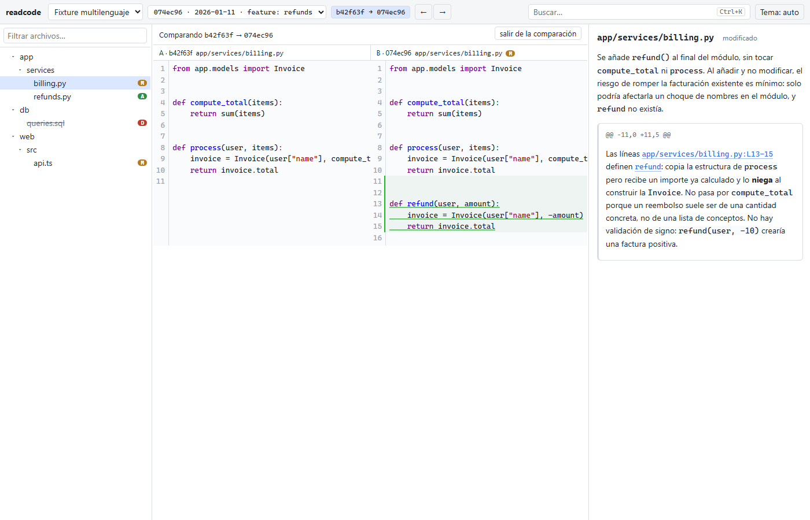

# readcode

readcode genera **estudios** de repositorios de código (índice de símbolos, explicaciones por bloque y por archivo, recorridos guiados, grafos y diffs explicados entre commits) y trae un visor web para leerlos. El núcleo en Python es determinista y **nunca llama a un LLM**: la skill `/readcode` de Claude Code reparte el trabajo en subagentes que redactan las explicaciones, y el núcleo las valida y las sirve.





## Requisitos

- Python >= 3.11 y git.
- Claude Code, para generar estudios con la skill (ver y validar estudios no lo necesita).
- Opcional: [graphify](https://pypi.org/project/graphifyy/) para el grafo (`pip install graphifyy`) y [Archify](https://github.com/tt-a1i/archify) para diagramas (`npx skills add tt-a1i/archify -g`). Sin ellos el estudio se genera igual, sin grafo ni diagramas Archify.
- Node solo para desarrollar el visor. El visor ya está compilado en `core/readcode/viewer_dist/`, así que `readcode serve` no necesita Node.
- Red la primera vez que se indexa un lenguaje: `tree-sitter-language-pack` descarga las gramáticas bajo demanda.

## Instalación

En v1 el método soportado es la **instalación editable desde un clon**:

```bash
git clone https://github.com/aaramirez/readcode
cd readcode
pip install -e core        # o: pipx install -e core
readcode install-skill     # copia skills/readcode a ~/.claude/skills
readcode --help
```

Limitación: `schemas/` y `skills/` viven en la raíz del repo, fuera de `core/`, y el paquete los busca allí. Una instalación no editable (`pip install ./core` o `pipx install "git+https://github.com/aaramirez/readcode#subdirectory=core"`) instala el CLI y el visor, pero `validate`, `init`, `snapshot`, etc. fallan con "schemas/ not found" e `install-skill` no encuentra la skill (verificado). Empaquetarlos queda para una versión posterior. Para actualizar: `git pull` dentro del clon.

## Uso

Recomendado: un repo privado de conocimiento (por ejemplo `~/code-kb`) con varios estudios, uno por directorio, que versionas tú con git.

En Claude Code:

```text
/readcode study ~/proyectos/mi-app --kb ~/code-kb           # estudio nuevo del HEAD
/readcode update mi-app --kb ~/code-kb                       # nuevo snapshot; reutiliza lo que no cambió
/readcode diff mi-app <shaA> <shaB> --kb ~/code-kb           # explica el cambio entre dos commits
/readcode tour mi-app "cómo se emite una factura" --kb ~/code-kb
```

Para leerlo:

```bash
readcode serve ~/code-kb        # http://127.0.0.1:8765 (--port, --no-open)
```

Puedes probarlo ya con el estudio de ejemplo: `readcode serve examples/kb`.

## Formato del estudio

La fuente de verdad son los JSON Schema de [`schemas/`](schemas/); el diseño completo está en la [especificación](docs/superpowers/specs/2026-10-12-readcode-design.md) (§4). Estructura:

```text
<kb>/catalog.json
<kb>/<estudio>/study.json
<kb>/<estudio>/blobs/<2 primeros>/<hash>.txt           contenido deduplicado por sha256
<kb>/<estudio>/snapshots/<sha>/{tree.json, symbols.json, overview.md, issues.json,
                                explain/<ruta>.json, dirs/<ruta>.json,
                                tours/<id>.json, graph/graph.json, diagrams/}
<kb>/<estudio>/diffs/<shaA>..<shaB>/{changes.json, explain.md, explain/<ruta>.json}
```

Marcadores en el Markdown de las explicaciones:

| Marcador | Significado |
|---|---|
| `[[ref:ruta#símbolo]]` | enlace a un símbolo |
| `[[ref:ruta:L10-31]]` | enlace a un rango de líneas |
| `[[archify:nombre]]` | embebe `diagrams/nombre.html` |
| ```` ```mermaid ```` | diagrama Mermaid en línea |

Las referencias se resuelven en este orden: mismo archivo, archivos importados, todo el repo; si son ambiguas se conservan todos los candidatos y `readcode validate` informa las rotas.

## Referencia del CLI

Casi todos los comandos reciben `<kb> <estudio>` (ver `readcode <comando> --help`). Los SHA aceptan prefijo único.

| Comando | Qué hace |
|---|---|
| `readcode version` | Muestra la versión. |
| `readcode init <kb> <estudio> --repo <ruta\|url>` | Crea `<kb>/<estudio>/study.json`. |
| `readcode snapshot <kb> <estudio> --sha <rev>` | Snapshot de una revisión: blobs + `tree.json`. |
| `readcode index <kb> <estudio> --sha <sha>` | Símbolos, referencias e imports con tree-sitter: `symbols.json`. |
| `readcode plan <kb> <estudio> --sha <sha>` | Cola de trabajo para la skill: reutiliza explicaciones y lista lo pendiente (`--json`). |
| `readcode graph <kb> <estudio> --sha <sha>` | Grafo del snapshot con graphify (opcional). |
| `readcode diff <kb> <estudio> <shaA> <shaB>` | Calcula `changes.json` entre dos snapshots. |
| `readcode validate <kb> <estudio> [--sha] [--json]` | Valida schemas, rangos y refs; escribe `links.json` e `issues.json`; exit 1 si hay problemas. |
| `readcode catalog <kb>` | Regenera `<kb>/catalog.json`. |
| `readcode serve <kb> [--port] [--no-open]` | Sirve el visor en `/` y la KB en `/kb/`. |
| `readcode install-skill [--dest] [--force]` | Instala la skill `/readcode` en `~/.claude/skills`. |
| `readcode context <kb> <estudio> <rutas...> --sha <sha>` | Contexto de archivos para la skill: blob, defs, imports, usos, vecinos en el grafo. |
| `readcode stale <kb> <estudio> <shaA> <shaB>` | Documentos heredados que pueden haber quedado viejos tras un update. |
| `readcode mark <kb> <estudio> [--sha --status] [--archify true\|false]` | Fija el estado de un snapshot y/o `tools.archify`. |

## Desarrollo

```bash
pip install -e "core[dev]"
python -m pytest core/tests                 # tests del núcleo

cd viewer && npm install
npm run dev      # servidor de desarrollo de Vite
npm test         # Vitest
npm run check    # svelte-check
npm run build    # compila a core/readcode/viewer_dist (se versiona)
npm run e2e      # build + Playwright; requiere `readcode` en el PATH
```

El estudio de ejemplo `examples/kb/fixture` se escribió a mano sobre `examples/fixture-repo`. Para recrear el repo de prueba: `python examples/make_fixture.py`; luego `readcode init/snapshot/index/diff` generan la parte determinista, y `readcode validate examples/kb fixture` debe salir sin problemas.

## Licencia

Ver [LICENSE](LICENSE).
