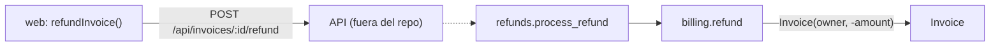

# Qué se buscó con estos cambios

El commit *feature: refunds* introduce **reembolsos de extremo a extremo**: el dominio Python
aprende a reembolsar y el cliente web aprende a pedirlo. De paso se limpia `db/` eliminando
consultas de exploración que ya no aportaban.

## La decisión de fondo: un reembolso es una factura negativa

En vez de un modelo `Refund`, [[ref:app/services/billing.py#refund]] crea una
[[ref:app/models.py#Invoice]] con total `-amount`. Por eso `models.py` y `db/schema.sql` **no
cambian**: el modelo y la tabla ya admitían totales negativos. Es un cambio barato, pero deja el
signo como única marca de "esto es un reembolso".

La línea discontinua es intencionada: el servidor HTTP que uniría la web con Python no está en
el repo, y en Python nadie llama todavía a
[[ref:app/services/refunds.py#process_refund]]. El cambio prepara las piezas en ambos extremos,
pero **no las conecta**.

## Archivo por archivo

| Archivo | Cambio | Por qué |
|---|---|---|
| `app/services/billing.py` | + `refund()` | Lógica del reembolso junto a la de facturación, reutilizando `Invoice`. |
| `app/services/refunds.py` | nuevo | Punto de entrada con nombre propio para el caso de uso. |
| `web/src/api.ts` | + `refundInvoice()` | El frontend puede solicitar el reembolso (POST). |
| `db/queries.sql` | eliminado | Consultas de exploración sin uso ([[ref:db/queries.sql:L1-2]]). |

## Qué revisar si continúas este trabajo

- Validar que `amount` sea positivo en `refund` (o en `process_refund`).
- Conectar `process_refund` a algún punto de entrada y comprobar autorización: hoy el token de
  [[ref:app/services/auth.py#process]] no se verifica en ningún sitio.
- Extraer en `api.ts` un helper común: `fetchInvoice` y `refundInvoice` repiten la misma
  gestión (incompleta) de errores.
