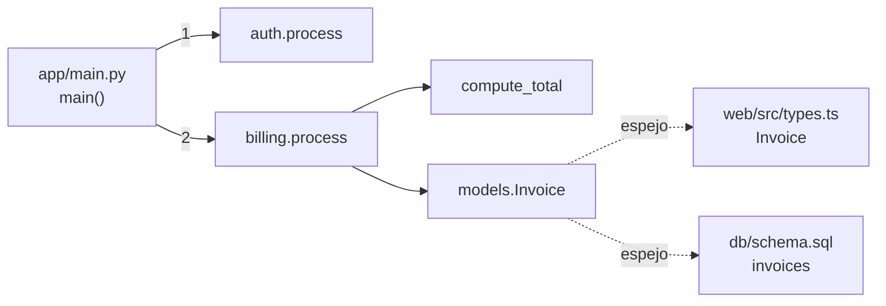

# Fixture multilenguaje

Un repositorio pequeño pensado para ejercitar readcode con **Python, TypeScript, Go y SQL**.
No es un sistema integrado: son tres programas que comparten un dominio (facturas) pero no
código.

[[archify:arquitectura]]

## Las piezas

| Pieza | Lenguaje | Qué hace | Por dónde empezar |
|---|---|---|---|
| `app/` | Python | Autentica a un usuario y le factura una lista de importes | [[ref:app/main.py#main]] |
| `web/` | TypeScript | Pide una factura a una API HTTP externa | [[ref:web/src/index.ts:L3]] |
| `worker/` | Go | Cola FIFO en memoria con un ejemplo de uso | [[ref:worker/main.go#main]] |
| `db/` | SQL | Esquema `users`/`invoices` (aún sin uso) | [[ref:db/schema.sql#invoices]] |

## El flujo principal

1. [[ref:app/main.py#main]] llama a [[ref:app/services/auth.py#process]], que añade un token al
   usuario.
2. Después llama a [[ref:app/services/billing.py#process]], que suma los importes con
   [[ref:app/services/billing.py#compute_total]] y construye un [[ref:app/models.py#Invoice]].

## Ideas clave para leerlo

- **Dos funciones `process`.** Están en módulos distintos y se distinguen por el módulo
  (`auth.process`, `billing.process`). Una referencia sin ruta como [[ref:#process]] es ambigua.
- **El modelo `Invoice` existe tres veces**: en Python, en TypeScript y como tabla SQL, y las
  tres copias no coinciden del todo (`owner` es un nombre en Python y un `user_id` en SQL).
- **La seguridad es simbólica**: el token se genera con `hash()` y nadie lo verifica.
- **El worker está aislado**: su cola ([[ref:worker/queue.go#Queue]]) es en memoria y no
  tolera colas vacías ni concurrencia.

## Recorridos

- *Flujo de facturación*: de `main()` al total, pasando por auth, billing y el modelo.
- *Worker y su cola*: cómo funciona la cola FIFO en Go y sus límites.
